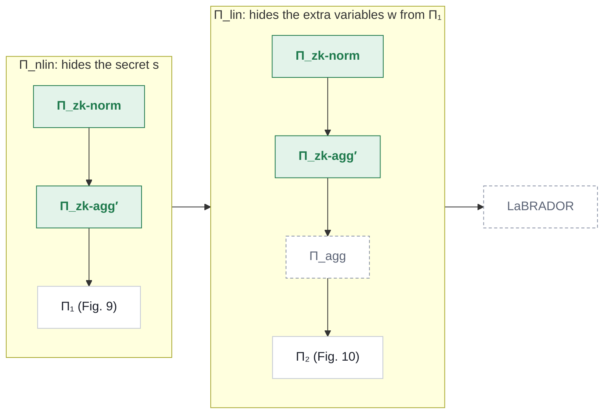

<sub>ePrint 2026/1822 §7.3–7.4 · App. B.2 &nbsp;↔&nbsp; lazer/src/labrados · branch zk-layer</sub>

# zk-norm and zk-agg′: Paper vs Code

This is a university project. It adds **zero-knowledge** to the LaBRADOR proof system, following Faonio–Tong, [*Non-Malleable Reductions of Knowledge*](https://eprint.iacr.org/2026/1822) (Section 7). This page compares the paper with the code step by step: the paper is on the left, the code on the right, and each step is tagged with how closely the code follows it.

This repository is a fork of [lazer-crypto/labrador](https://github.com/lazer-crypto/labrador); the original code and README are there.

> [!WARNING]
> Research code. Not reviewed for security. Do not use in production.

| Tag | Meaning |
|---|---|
| 🟢 **Same** | follows the paper |
| ⚪ **Implementation detail** | same protocol, different encoding |
| 🟡 **Simplified** | differs from the paper, to discuss |
| 🔴 **Missing** | not implemented yet |

**Sections:** [Big picture](#where-the-two-modules-sit) · [zk-agg′](#π_zk-agg-aggregating-constant-term-equations) · [zk-norm](#π_zk-norm-proving-the-secret-is-short) · [All differences](#all-differences-in-one-place) · [Tests](#how-the-tests-relate-to-the-papers-properties) · [Files](#what-was-added) · [Running](#how-to-run-the-tests) · [To do](#to-do)

---

## Where the two modules sit

The paper adds a zero-knowledge layer in front of plain LaBRADOR. The layer is a chain of small *reductions of knowledge*: each takes a (statement, witness) pair and outputs a new one. The chain below runs left to right.



🟢 green: implemented on this branch · dashed: already in the library · plain: still to do

Both modules replace the two LaBRADOR steps that leak information about the secret:

- **π_zk-norm** replaces the JL norm check. LaBRADOR sends the projection `Π·s` in the clear.
- **π_zk-agg′** replaces the constant-term aggregation. LaBRADOR sends the "lifts" in the clear.

The code follows the library's convention for one step: `prove(pi, ost, owt, ist, iwt, pp)` for the prover and `reduce(ost, ist, pi, pp)` for the verifier, as in `ldr_prove` / `ldr_reduce`.

---

## π_zk-agg′: aggregating constant-term equations

Paper: §7.4 and App. B.2. Code: `zkagg.c`, `zkagg.h`. Goal: turn the equations that only need to hold on the constant term (`F′`) into a few full equations over R_q, without leaking anything.

<table>
<tr><th width="50%">Paper</th><th width="50%">Our code</th></tr>

<tr><td valign="top">

**1 · Sample the masks**

```text
∀k ∈ [λ′]:  g_k ←$ R_q  with  ct(g_k) = 0
```

One random polynomial per lift. Its constant term is 0 and every other coefficient is uniform mod q.

</td><td valign="top">

🟢 **Same**

```c
polzvec_uniform(g, LIFTS, seed, 0);
g[i]->limbs[j]->c[0] = 0;   // ct(g_k) = 0
polz_center(g[i]);
```

`LIFTS` = λ′ = ⌈128 / log q⌉ = 4 for this library's q ≈ 2³⁸.

<sub>`zka_prove`</sub>

</td></tr>

<tr><td valign="top">

**2 · Commit to the masks**

```text
c_g, t_g ← DCom*(ck, (g_k)_k)
```

A *hiding* double commitment (§7.1): randomized with a Gaussian sample from the gadget lattice Λ.

</td><td valign="top">

⚪ **Implementation detail** · 🟡 **Simplified**

```c
polzvec_bindec(&w[i*LOGQ], &g[i], 1, 1, LOGQ);  // g as bits
polyvec_ternary(&w[pp->glen], 1, pp->rlen, seed, 1);   // padding r
commit(cgx, wx);              // c_g = A·(ĝ ‖ r)
```

g is huge, so it is stored as 38 binary polynomials `ĝ` (as in `lnp.c`). The commitment is a plain Ajtai commitment to `(ĝ ‖ r)` with ternary padding `r`. Its length comes from the paper's Lemma 32 (`rlen > (κ·log q + 2λ/N)/log₂3`). It is not DCom*. Nothing yet proves that `ĝ` is binary.

<sub>`zka_prove` · `zka_params_gen`</sub>

</td></tr>

<tr><td valign="top">

**3 · Verifier challenges**

```text
∀k: ψ_k ←$ Z_q^{K′}
```

Random coefficients for combining the K′ constant-term equations, one vector per lift.

</td><td valign="top">

🟢 **Same**

```c
update_hash_polz(h, pi->m[0], pp->kappa); // hash c_g
sample_chalz(chalz, nchalz, h);          // ψ_k
zqcnstset_aggregate_add(zqagg[i], ist->zqcnst, chalz, chalx);
```

Fiat–Shamir: the challenges come from the hash of the transcript, which already contains `c_g`. This is a copy of the library's `ldr_aggregate_zq` without the JL part.

<sub>`zka_aggregate_zq`</sub>

</td></tr>

<tr><td valign="top">

**4 · Masked lifts**

```text
b_k ← g_k + Σ_j ψ_kj · q′_j(s)
```

The aggregated value has a leaking higher part. Adding g_k makes it uniformly random. b_k is sent in the clear.

</td><td valign="top">

🟢 **Same**

```c
sparsecnst_eval(liftx, zqagg[i], sxq, sxl); // Σ ψ_kj f′_j(s)
polxvec_add(liftx, liftx, gx);              // + g_k
polzvec_frompolxvec(&pi->m[1][i], liftx, 0, 1, 1);
```

The library folds the constants b′_j into the evaluation, so the evaluated value already has constant term 0. This is the one-line difference from `ldr_prove`, which sends the value without `+ g_k`.

<sub>`zka_prove`</sub>

</td></tr>

<tr><td valign="top">

**5 · Verifier check**

```text
ct(b_k) = Σ_j ψ_kj · b′_j
```

</td><td valign="top">

🟢 **Same**

```c
check &= polxvec_iszero_constcoeff(liftx, i);
if(!check) return 1;   // reject
```

Same check in the library's convention (constants folded in, so the target is 0).

<sub>`zka_reduce`</sub>

</td></tr>

<tr><td valign="top">

**6 · New statement**

```text
f″_k(s, g) := Σ_j ψ_kj q′_j(s) + ⟨δ_k, g⟩ − b_k
return (c, F ∪ (f″_k)_k, ∅)
```

The new witness is (s, g). The constant-term list F′ is now empty.

</td><td valign="top">

🟢 **Same** · ⚪ **Implementation detail**

```c
zqagg[i]->b += b_k;                       // right-hand side
lin->off[1] = nn_in + i*LOGQ;             // reads ĝ_k
polxvec_powers(phi[1], 2, 1, -1);         // 1,2,…,−2³⁷
ps_addcheck_commit_in_clear(com[nc], c_g, kappa, nn_in, wlen);
```

The term ⟨δ_k, g⟩ reads g back from its bits with the gadget (1, 2, 4, …, −2³⁷); the last weight is negative because the bits are two's complement. The commitment equation `Com(ĝ ‖ r) = c_g` is added explicitly. The output Z_q equation set is empty.

<sub>`zka_finish_statement` (shared by prover and verifier)</sub>

</td></tr>
</table>

---

## π_zk-norm: proving the secret is short

Paper: §7.3, Fig. 8. Code: `zknorm.c`, `zknorm.h`. Goal: show that ‖s‖ is small with a JL projection, without revealing the projection.

<table>
<tr><th width="50%">Paper</th><th width="50%">Our code</th></tr>

<tr><td valign="top">

**1 · Sample the masks**

```text
y₁ ← D_{σ₁}^{2λ₁},  y₂ ← D_{σ₂}^{2λ₂},  r ←$ U_η^{n_r}
```

Gaussian noise for the projection of s (y₁) and for the projection of the commitment digits t (y₂), plus hiding randomness r.

</td><td valign="top">

🟢 **Same** · 🔴 **Missing: y₂**

```c
gaussian_i32(y, 256, &gstate, pp->logsd);   // y₁, 2λ₁ = 256
polyvec_ternary(&w[pp->ybits], 1, pp->rlen, seed, …);  // r, η = 1
```

σ is 1.55·2^logsd, the format of the library's sampler. There is no y₂: this layer's input statement has no commitment digits t yet, so their projection is skipped.

<sub>`zkn_prove`</sub>

</td></tr>

<tr><td valign="top">

**2 · Commit to the masks**

```text
c_y ← Com(ck_B, y),  y := (y₁ ‖ y₂ ‖ r)
```

</td><td valign="top">

🟢 **Same** · ⚪ **Implementation detail**

```c
polzvec_bindec(w, &yz, 1, 1, pp->ybits);  // y as bits ŷ
commit(cyx, wx);                          // c_y = A·(ŷ ‖ r)
```

y₁ is stored as binary digits `ŷ` so the new witness vector stays short (the paper's bound grows by 4λ₁σ₁², which is large). Hiding as in Lemma 32.

<sub>`zkn_prove`</sub>

</td></tr>

<tr><td valign="top">

**3 · JL challenge**

```text
∀i: Π_i ←$ Bin₁^{2λ₁ × nd}
```

</td><td valign="top">

🟢 **Same**

```c
update_hash_polz(h, pi->cy, pp->kappa);
jl_sample_mat(&jlmat1, &jlmat2, h, pp->nn_in);
```

The library's own JL sampler. Bin₁ entries are the difference of two binary matrices.

<sub>`zkn_prove` · `zkn_reduce`</sub>

</td></tr>

<tr><td valign="top">

**4 · Masked projection**

```text
z₁ ← Σ_i Π_i s_i + y₁
z₂ ← Σ_ij Π′_ij t_ij + y₂
```

</td><td valign="top">

🟢 **Same** · 🔴 **Missing: z₂**

```c
jl_project(v, iwt->s[0], pp->nn_in, jlmat1, jlmat2);
pi->z[k] = v[k] + y[k];
```

<sub>`zkn_prove`</sub>

</td></tr>

<tr><td valign="top">

**5 · Rejection sampling**

```text
Abort if Rej(z_i, z_i − y_i, σ_i, ρ) = 1
```

Keeps z only with a probability that makes it look like Gaussian noise centred at 0, whatever s is.

</td><td valign="top">

🟢 **Same**

```c
if(!is_rejected_std0(&rstate, ⟨z,v⟩, ⟨v,v⟩, σ², M)
   && ‖z‖² ≤ 512·σ²)  break;
pi->nrej++;   // otherwise: fresh y, r, c_y, Π
```

On abort, the loop restarts with a new mask, a new commitment and a new challenge. σ = γ·√337·β with γ ≈ 16 and M = exp(14/γ + 1/2γ²) ≈ 1.9. This formula is taken from `lnp.c`, not from the paper.

<sub>`zkn_prove` · `zkn_params_gen`</sub>

</td></tr>

<tr><td valign="top">

**6 · Verifier norm check**

```text
∀i: ‖z_i‖₂ < σ_i·√(4λ_i)
```

</td><td valign="top">

🟢 **Same**

```c
if(jlproj_normsq(pi->z) > 512 * σ²) return 1;   // 4λ₁ = 512
```

<sub>`zkn_reduce`</sub>

</td></tr>

<tr><td valign="top">

**7 · New statement**

```text
f′_k(s, y) := Σ_i ⟨σ⁻¹(π_i^(k)), s_i⟩ + ⟨δ_k, y₁⟩ − (z₁)_k
return (c, F, F′ ∪ (f′_k)_k, β′, γ)
```

256 constant-term equations (Eq. 5), one per projected coordinate, plus κ₁ equations for c_y = Com(y).

</td><td valign="top">

🟡 **Simplified**

```c
jlproj_expand_challenge(chalz, …);           // c ∈ Z_q^256
jl_aggregate_mat(phi[0], jlmat1, jlmat2, chalz); // Σ c_k ⟨π_k, s⟩
phi[1][b] = w_b · a;   // a = c₀ − Σ c_k X^(N−k): reads y from ŷ
b = jlproj_collapsproj(z, chalz);            // Σ c_k z_k
```

Writing out 256 equations would need 256 vectors as long as the witness. Instead the verifier draws 4 random Z_q combinations (public coins, no prover message) and outputs those. A wrong row survives each combination with probability 1/q. The commitment equation for `c_y` is added too. The norm bound β′ on s is not updated yet.

<sub>`zkn_projection_cnsts` · `zkn_build_statement`</sub>

</td></tr>
</table>

---

## All differences in one place

| Topic | Paper | Code | Status | Effort to align |
|---|---|---|---|---|
| Mask encoding | y and g are witness values | Stored as binary digits ŷ, ĝ and recombined with powers of 2 | ⚪ Implementation detail | None; keeps norms small |
| Digits are binary | n/a | Not enforced: equations only use the recombined value | 🟡 Simplified | Small: add constant-term equations proving each digit is 0 or 1 (the trick Dachshund uses) |
| Hiding commitment | DCom* with a lattice Gaussian (§7.1) | Ajtai commitment with ternary padding (Lemma 32) | 🟡 Simplified | Medium: needs a gadget-lattice Gaussian sampler |
| Projection equations | 256 separate constant-term equations | 4 random Z_q combinations of them | 🟡 Simplified | Small to write, but memory-heavy |
| Projection of t | z₂ = Π′t + y₂ | Not implemented | 🔴 Missing | Small, once the layer's input carries commitments |
| σ and M | σ₁ = ω(β√log λ₁), from Lemmas 5 and 9 | Formula from `lnp.c`: γ ≈ 16, M ≈ 1.9 | 🟡 Simplified | Small: check against the paper's constants. Observed retries 1.0–1.5 vs 0.9 expected |
| Output norm bound | β′ = √(β² + 4λ₁σ₁² + …) | Input bounds copied, new vector bounded separately | 🟡 Simplified | Small |
| Lift aggregation | b_k sent in the clear | b_k sent in the clear | 🟢 Same | None |
| Fiat–Shamir | Challenges from RO(pp ‖ x ‖ transcript) | Running 16-byte SHAKE128 hash `h` carried in the statement | 🟢 Same | None |

---

## How the tests relate to the paper's properties

| Paper property | What the test does | File |
|---|---|---|
| Completeness (Lemma 13, Thm. 9) | Honest prover. Prover and verifier derive the same statement (same hash), and `verify()` accepts the new witness. | `test_zkagg.c`, `test_zknorm.c` |
| Soundness, sanity level (Lemmas 14, 17) | A lift with non-zero constant term, or an oversized z, is rejected. A modified b_k or z no longer verifies. | both |
| Composition (Thm. 5) | zk-norm → zk-agg′ → `ldr_prove` / `ldr_reduce` verifies end to end. | both |
| Rejection rate (Lemma 5) | Average retries per proof printed; expected about M − 1 ≈ 0.9. | `test_zknorm.c` |
| Partial zero-knowledge (Lemmas 15, 16) | Not tested yet. A statistical test could compare z with D_σ and check that b_k's higher coefficients are uniform. | to do |

---

## What was added

Everything is in this folder. No existing LaBRADOR file was edited: the new code only *uses* existing functions.

| File | Content |
|---|---|
| `zkagg.h`, `zkagg.c` | π_zk-agg′: `zka_params_gen`, `zka_prove` (prover), `zka_reduce` (verifier) |
| `zknorm.h`, `zknorm.c` | π_zk-norm: `zkn_params_gen`, `zkn_prove` (prover), `zkn_reduce` (verifier) |
| `test_zkagg.c`, `test_zknorm.c` | tests (see the table above) |
| `Makefile` | two new targets: `test_zkagg`, `test_zknorm` |

## How to run the tests

The code needs a CPU with **AVX-512**.

```bash
make CC=gcc test_zkagg test_zknorm
./test_zkagg
./test_zknorm
```

**No AVX-512 on your CPU?** Compile for it anyway and run the tests with the Intel SDE emulator (slow, but it works):

```bash
CFLAGS="-mavx512f -mavx512bw -mavx512dq -mavx512vl -mavx512vbmi -mavx512vbmi2 -mavx512vnni -maes -mvaes" \
  make CC=gcc test_zkagg test_zknorm
sde64 -- ./test_zkagg
sde64 -- ./test_zknorm
```

Each test should end with `all tests passed`. Lines like `(expected error below) ERROR in verify()` are **normal**: the tests break proofs on purpose to check that broken proofs get rejected. A real problem shows up as a line starting with `FAIL:`.

## To do

- [x] zk-agg′
- [x] zk-norm (without the projection of `t`)
- [ ] Check the retry rate on many runs (a bit higher than expected so far)
- [ ] Discuss the simplifications with the supervisor
- [ ] Π₁ (paper §7.5, Fig. 9)
- [ ] Π₂ (paper §7.6, Fig. 10)
- [ ] Connect everything and compare speed with plain LaBRADOR
